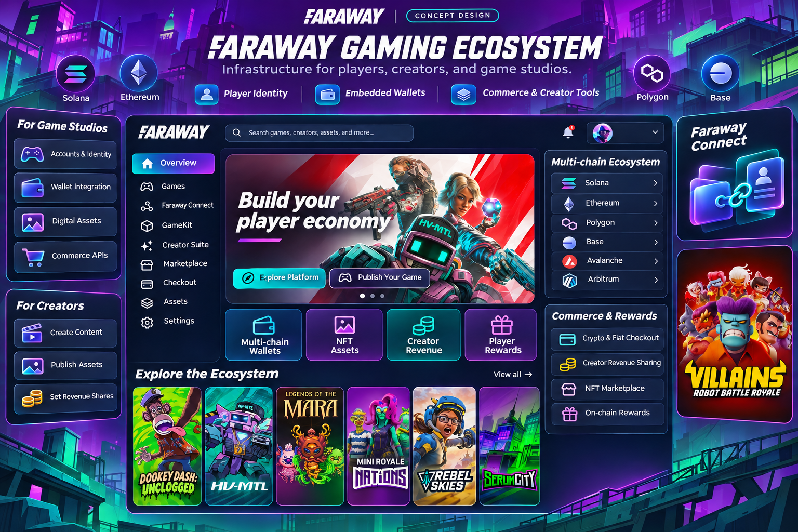
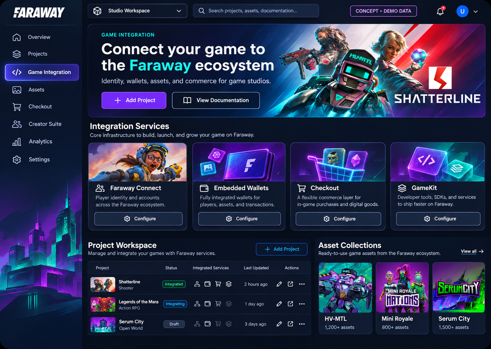
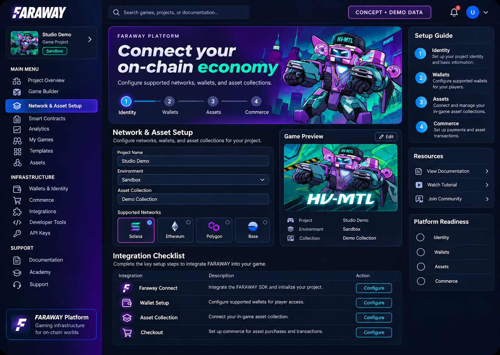
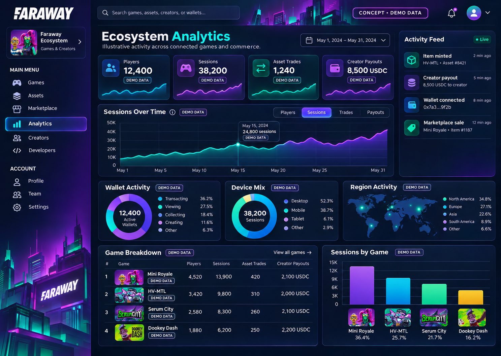

# Faraway Gaming Ecosystem - MVP

Faraway Gaming Ecosystem is a project focused on building a modern gaming network designed to support the evolving Web3 gaming ecosystem. The project aims to provide a foundation for connecting gaming experiences with blockchain technology, digital assets, and decentralized infrastructure.
The MVP establishes the initial platform structure and development foundation for future functionality, integrations, and product enhancements.

## Project Overview

The project explores how a game studio could manage its blockchain integrations and player economy from a single workspace.

The interface brings together:

- Player accounts and wallet integration
- Game projects and asset collections
- NFT marketplaces and creator tools
- Payments and revenue sharing
- Player rewards and ecosystem analytics

## Main Screens


## Ecosystem Overview

Introduces the ecosystem, highlights participating games, and presents the platform’s core services.


| Game Integration Portal | Network and Asset Setup | Ecosystem Analytics |
|:-----:|:--------------:|:-----------------:|
|  |  |  |

---

## Proposed Platform Modules

| Module | Purpose |
| --- | --- |
| Player Identity | Connect player accounts across participating experiences |
| Embedded Wallets | Simplify access to supported blockchain assets |
| Asset Management | Organize game items and NFT collections |
| Commerce | Support purchases, marketplaces, and payment distribution |
| Creator Tools | Help creators publish content and manage revenue shares |
| Rewards | Support token or NFT reward distribution |
| Analytics | Present game activity and economy metrics |


## Design Direction

- Dark navy interface
- Purple and teal accents
- Game artwork and ecosystem showcases
- Consistent navigation across dashboard screens
- Clearly labeled concept content and demo metrics

## Technology Stack

| Component | Technologies |
|---|---|
| Frontend | React / Next.js / TypeScript |
| Backend | Node.js |
| Database | MongoDB |
| Blockchain | Ethereum / EVM-Compatible Networks |
| Smart Contracts | Solidity / OpenZeppelin |
| AI Integration | AI-Powered Services |
| Development Tools | npm / Git / GitHub |

## Getting started

```bash
# 1. Install Backend dependencies
npm install

# 2. Install Frontend dependencies
cd client
npm install
cd ..

# 3. Launch Project
npm start
```

## References

- Faraway: https://faraway.com/
- Developer Platform: https://faraway.com/dev-platform